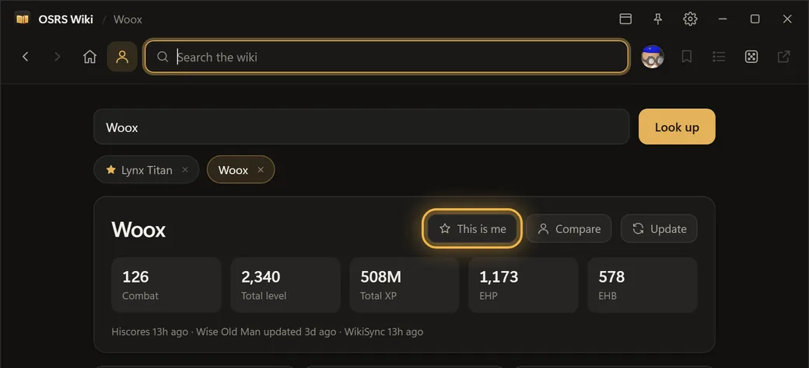
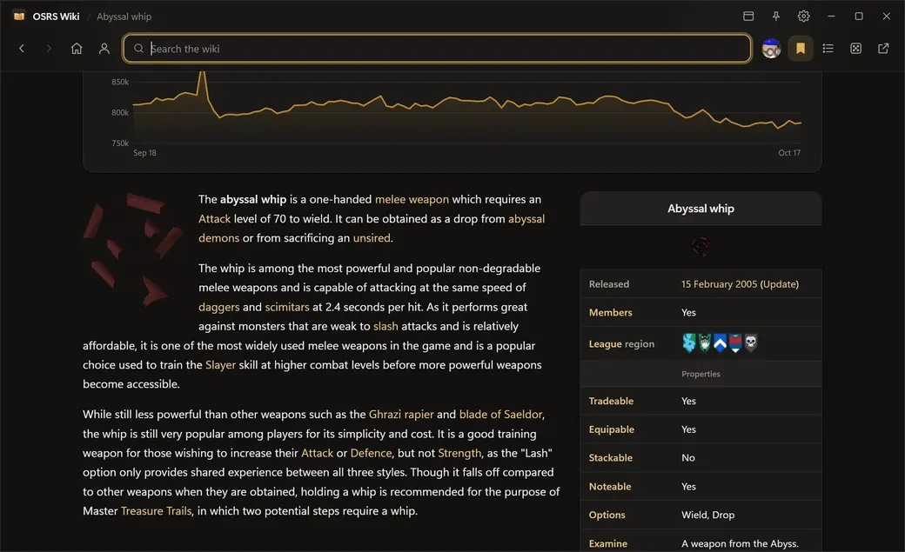
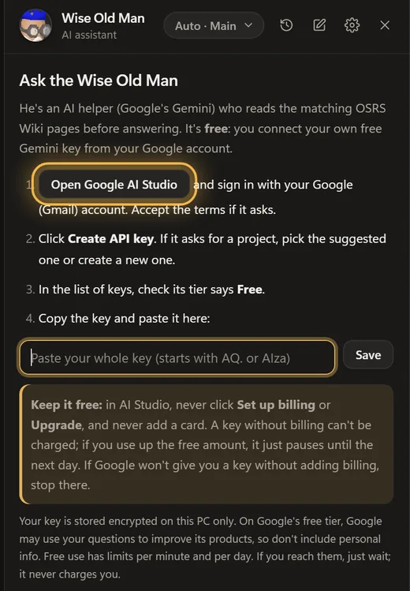

# OSRS Wiki Reader

A small, fast desktop window for the [Old School RuneScape Wiki](https://oldschool.runescape.wiki), for looking things up while you play without opening a browser.

**[Download the latest version](../../releases/latest)**: grab `OSRS.Wiki.Reader.exe` and double-click it. Nothing to install. It updates itself when a new version comes out.

> Windows may say "Windows protected your PC" the first time, because the app isn't code-signed. Click **More info → Run anyway**.

## Quick start

1. **Download and run** `OSRS.Wiki.Reader.exe`. If Windows warns you, click **More info → Run anyway** (only the first time).
2. **Set your account**: open the Character tab (person icon), look up your name and press **This is me**. Quest and skill pages then tick off what you meet, and the Wise Old Man knows your levels.

   

3. **Connect the Wise Old Man** (optional, free): click his face in the toolbar and follow the steps to get a free Gemini key (see [Getting a free Gemini key](#getting-a-free-gemini-key) below).
4. **Hotkeys**: if they clash with your game, open Settings (gear) and click a hotkey to change it.

The first time you open the app, a short **guided tour** walks you through all of this: it opens each screen, highlights where to click and tells you what to do. Press **F1** any time for the Quick guide (shortcuts and tips) or to take the tour again.



## Getting a free Gemini key

The Wise Old Man uses Google's Gemini with **your own free key**. It takes about a minute:

1. Open [Google AI Studio](https://aistudio.google.com/apikey) and sign in with your Google (Gmail) account. Accept the terms if it asks.
2. Click **Create API key**. If it asks for a project, pick the suggested one or create a new one.
3. In the list of keys, check its tier says **Free**.
4. Copy the key and paste it into the Wise Old Man chat in the app.



> **Keep it free:** in AI Studio, never click **Set up billing** or **Upgrade**, and never add a card. A key without billing can't be charged; if you use up the free amount, it just pauses until the next day. Billing applies to the whole Google project, so adding it would make every key in that project paid. If Google won't give you a key without adding billing, stop there.

## Keyboard shortcuts

| Keys | What it does |
| --- | --- |
| Ctrl+Alt+W | Show / hide the reader from anywhere (default, changeable) |
| Ctrl+Alt+Q | Open the Wise Old Man from anywhere (default, changeable) |
| Ctrl+K or / | Search |
| Ctrl+F | Find on page (Enter / Shift+Enter for next / previous) |
| Ctrl+N | New Wise Old Man chat |
| Ctrl+Tab | Flip between recent pages (hold Ctrl, press Tab again to go further back) |
| Alt+Left / Right | Back / forward (mouse side buttons work too) |
| Ctrl + / Ctrl - / Ctrl+0 | Bigger / smaller / reset text size |
| Esc | Close menus or the chat |
| F1 | Open the Quick guide |

## What it does

- **Wiki reader**: a calm, polished design with auto, dark and light themes, search with autocomplete, find on page (Ctrl+F), bookmarks, history. Tables shrink to fit narrow windows.
- **Global hotkeys** you can set to any combination: show/hide (Ctrl+Alt+W) and open the Wise Old Man (Ctrl+Alt+Q), even in-game. Ctrl+N starts a new chat.
- **Works like a normal Windows 11 window**: the Snap Layouts bar when you drag it to the top, edge and corner snapping, Snap Assist, Win+Arrow keys, and maximize (button or double-click the top bar). Plus a **pin** to keep it above the game and a **mini mode** search strip.
- **Character tab**: look up any account's levels, boss kills and clues (official hiscores), weekly gains (Wise Old Man), and quests/diaries (WikiSync). Compare two accounts side by side.
  - Goals (closest 99s, next level-ups, hours to max), milestones with dates, your best day/week/month/year, and an XP-over-time chart.
  - Your Group Ironman group, with every member's levels.
  - Pet chances: every boss pet ranked by how likely you'd have it by your kill count.
  - Your account stays fresh on Wise Old Man: the app updates it every 6 hours while it's open (only if Wise Old Man already tracks it; switch off in Settings).
  - Combat achievements: points, the reward tier you've unlocked, how far to the next, and progress per tier (needs WikiSync).
  - **Share**: a picture of your profile to paste into Discord.
- **Collection log** (via WikiSync: open your collection log in game and press its **WikiSync** button): your progress and pets on the profile, ticks for the pets you have, "logged" on boss drops with how lucky or dry you are, and "In your collection log" on item pages. The Wise Old Man knows what you've already got.
- **Your kill count on boss pages**: open a boss, clue or minigame page and it shows your KC, rank and this week's kills, plus your pet luck (how many players would have the pet by your kill count) and the collection log drops you'd expect by now.
- **Recommended gear on boss pages**: the best and budget pick for every slot, per combat style, from the wiki's strategy guides.
- **Bank import**: paste your bank from RuneLite's [Bank Memory](https://github.com/Lazyfaith/runelite-bank-memory-plugin) plugin ("Copy item data to clipboard"). Item pages then show how many you have; boss gear and strategy guides tick what you own and suggest your next upgrade (with GE prices); quest pages tick the items you already have; the Bank card shows its GE value, lets you search it, and lists what you could make from it right now (most XP / most profit); each gear upgrade has a "Where?" link (drops, shops, recipes, quests); armour set pages (Barrows, metal, dragonhide...) show which pieces you own; and the Wise Old Man knows your relevant gear. It stays on your PC.
- **Can I kill / cast this?** Monster pages show the Slayer level needed (and which masters assign it), spell pages the Magic level and spellbook, checked against your levels.
- **Home screen**: your pinned goal (pin any goal from your profile), this week's XP, level-ups and boss kills, the latest game update, and a "Did you know?" fact from the wiki's Fun Facts series.
- **Requirement checks**: set your account and quest, diary and guide pages tick off what you meet. The Character tab lists quests you can start now.
- **XP calculator** on skill pages, with training methods from the wiki.
- **Ask the Wise Old Man**: an AI helper (Google's Gemini) that answers from the matching wiki pages and your stats, with Ironman, Hardcore, Ultimate, Group and Hardcore Group Ironman modes, and can open wiki pages for you.
  - Like a code editor, he sees the page you're reading and any text you highlight (or press **Ask about this**).
  - The chat docks beside the page instead of covering it; drag its edge to resize.
  - Your last 10 chats are saved, so you can pick one up again later.
  - Free: you connect your own free Gemini key from [Google AI Studio](https://aistudio.google.com/apikey), with no billing needed.
- **Light on your PC**: when hidden it puts the page to sleep and frees memory, and wakes instantly.

Quest and diary progress needs the free **WikiSync** plugin enabled in RuneLite.

**Privacy**: your Gemini key is stored encrypted on your PC (Windows DPAPI), and your chat history stays on your PC. Questions go to Google's Gemini to be answered.

## Building from source

Windows 10/11 with Python 3.10+:

```powershell
powershell -ExecutionPolicy Bypass -File build.ps1
```

This creates `dist\OSRS Wiki Reader.exe`. The UI lives in `ui/` (plain HTML/CSS/JS rendered with WebView2 via [pywebview](https://pywebview.flowrl.com/)); `app.py` handles the wiki, hiscores and prices APIs.

## Credits

Unofficial fan project, not affiliated with Jagex or the OSRS Wiki.
Wiki content is licensed [CC BY-NC-SA 3.0](https://creativecommons.org/licenses/by-nc-sa/3.0/). Prices from the [OSRS Wiki Real-time Prices API](https://prices.runescape.wiki), player data from the official hiscores, [Wise Old Man](https://wiseoldman.net) and WikiSync.
